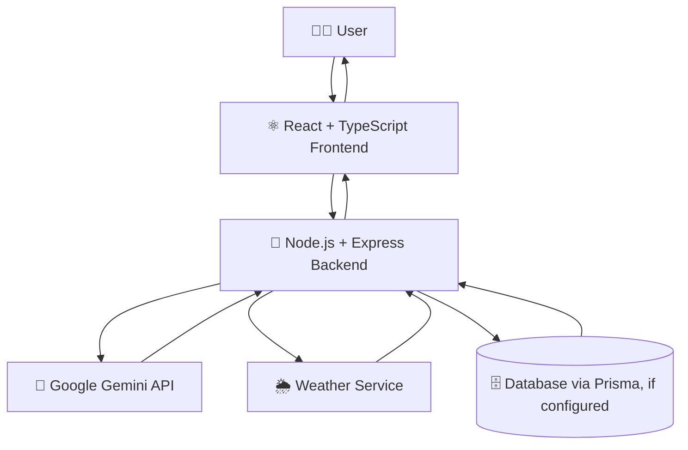

 <div align="center">


<br/>

<a href="https://github.com/meghanagowda75/Farm_Intellect">
  
</a>

<br/><br/>

<p>
  <a href="https://github.com/meghanagowda75/Farm_Intellect">
    
  </a>
  <a href="#-quick-start">
    
  </a>
  <a href="#-features">
    
  </a>
  <a href="#-contributing">
    
  </a>
</p>

<p>
  
  
  
  
  
</p>

<br/>

### 🌱 *From the soil that feeds us to technology that empowers farmers.*

**Farm Intellect** is an AI-powered agriculture project designed to help farmers access useful farming information, explore crop recommendations, understand weather conditions, and make more informed decisions.

</div>

---

## 📑 Table of Contents

- [✨ About the Project](#-about-the-project)
- [🎯 Objectives](#-objectives)
- [🌟 Features](#-features)
- [🎨 Tech Stack](#-tech-stack)
- [🏗️ Architecture](#️-architecture)
- [📂 Project Structure](#-project-structure)
- [🚀 Quick Start](#-quick-start)
- [⚙️ Environment Configuration](#️-environment-configuration)
- [🔌 API Overview](#-api-overview)
- [🔐 Authentication and Data](#-authentication-and-data)
- [🧪 Testing](#-testing)
- [🗺️ Future Enhancements](#️-future-enhancements)
- [🤝 Contributing](#-contributing)
- [📜 License](#-license)

---

## ✨ About the Project

Agriculture is affected by changing weather, crop diseases, uncertain market prices, and the difficulty of finding reliable farming information. Digital tools can help farmers organize this information and make better-informed decisions.

**Farm Intellect** combines a React-based user interface with a Node.js and Express backend. Google Gemini can be used through the backend to provide AI-powered responses and agriculture-related recommendations.

The project includes interfaces and backend functionality for farming assistance, weather information, crop planning, market-price prediction, and other agriculture-related features.

The exact functionality available depends on the implementation, backend configuration, and external API availability.

> 🎯 **Goal:** Make useful agricultural information easier to access through an approachable digital platform.

## 🎯 Objectives

- 🌾 Provide a digital platform for agriculture-related information.
- 🤖 Use AI to support farming questions and recommendations.
- 🌦️ Help users access weather-related information.
- 💹 Explore market-price insights to support selling decisions.
- 📅 Support crop planning and farming decision-making.
- 📱 Provide a responsive interface for different screen sizes.
- 🔧 Maintain a modular codebase that can be extended with additional features.

## 🌟 Features

### 🤖 AI-Powered Farming Assistance

- Integration with Google Gemini through the backend.
- AI-generated agriculture-related responses and recommendations.
- Backend routes for selected AI-assisted features.
- Configuration of the model through environment variables.

*AI-generated information should be checked against trusted agricultural guidance before making important farming decisions.*

### 🌦️ Weather Information

- Weather-related backend functionality.
- City-based weather requests.
- Weather information presented through the application interface.
- External weather data availability depends on the configured service.

### 🌱 Crop Planning and Recommendations

- Agriculture-related crop recommendations.
- Crop rotation planning functionality.
- Inputs and outputs designed to support farming decisions.
- Recommendations may depend on the configured AI service and available inputs.

### 💹 Market-Price Prediction

- Market-price prediction functionality through the backend.
- Support for selected crop inputs.
- Forecasts intended to help users explore potential price trends.
- Results are estimates and are not guaranteed future market prices.

### 👥 User Interface and Administration

- React components for application pages and features.
- User and role management interface.
- Responsive layouts and reusable UI elements.
- Authentication behavior depends on the configured application mode.

### 🌿 Extensible Agriculture Platform

The modular design makes it possible to add features such as crop disease assistance, irrigation guidance, soil information, multilingual support, and additional agricultural data integrations as those capabilities are implemented and tested.

---

## 🎨 Tech Stack

<div align="center">

### Frontend


### Backend


### Development Tools


</div>

| Layer | Technology | Purpose |
|---|---|---|
| Frontend | React | Component-based user interface |
| Language | TypeScript | Typed frontend code |
| Build tool | Vite | Development server and frontend builds |
| Styling | Tailwind CSS | Utility-based styling |
| UI components | Reusable React UI components | Consistent interface elements |
| Backend runtime | Node.js | Server-side JavaScript runtime |
| Backend framework | Express | HTTP API and route handling |
| AI integration | Google Gemini API | AI-generated responses and recommendations |
| Data access | Prisma | Database access where configured |
| Package manager | npm | Dependency installation and scripts |
| Version control | Git and GitHub | Source-code management |

**Note:** This project does not require Supabase. The database engine and required database settings depend on the current Prisma configuration in the repository.

---

## 🏗️ Architecture

Farm Intellect uses a frontend-and-backend architecture. The frontend sends requests to the backend, which handles the relevant route and communicates with configured services when necessary.



### Request Lifecycle

1. A user interacts with a page or feature.
2. The frontend sends a request to the backend API.
3. The backend validates and processes the request.
4. When required, the backend calls a configured external service.
5. The backend returns the response to the frontend.
6. The frontend displays the result to the user.

External service calls require valid configuration and network access. Database operations require a correctly configured database connection.

---

## 📂 Project Structure

The main repository is organized into frontend and backend areas.

```text
Farm_Intellect/
│
├── public/                       # Public frontend assets
├── src/
│   ├── components/               # UI and feature components
│   │   ├── features/             # Agriculture and platform features
│   │   ├── layout/               # Shared application layout
│   │   └── ui/                   # Reusable UI components
│   ├── contexts/                 # React contexts, including auth context
│   ├── lib/                      # API helpers and utilities
│   ├── pages/                    # Application pages, if present
│   └── ...                       # Other frontend source files
│
├── backend/
│   ├── src/
│   │   ├── config/               # Backend configuration
│   │   ├── middleware/           # Request middleware
│   │   ├── routes/                # Express API routes
│   │   ├── services/              # Services, including AI integration
│   │   └── server.js              # Backend entry point
│   ├── .env.example               # Backend environment template, if present
│   └── package.json               # Backend scripts and dependencies
│
├── tests/                         # Tests, if present
├── .env.example                   # Frontend environment template, if present
├── .gitignore                     # Git exclusions
├── package.json                   # Frontend scripts and dependencies
├── vite.config.ts                 # Vite configuration
└── README.md                      # Project documentation
```

*This is a high-level overview. Some folders may differ depending on the current version of the repository.*

---

## 🚀 Quick Start

### Prerequisites

Install the following tools:

- [Node.js](https://nodejs.org/) — use a version compatible with the project dependencies.
- npm — included with Node.js.
- [Git](https://git-scm.com/) — to clone the repository.
- A Google Gemini API key if you want to use Gemini-powered backend features.

### 1. Clone the Repository

```bash
git clone https://github.com/meghanagowda75/Farm_Intellect.git
cd Farm_Intellect
```

### 2. Install Frontend Dependencies

```bash
npm install
```

### 3. Install Backend Dependencies

```bash
cd backend
npm install
cd ..
```

### 4. Configure Environment Variables

Create the required local environment files based on the example files in the repository. See [Environment Configuration](#️-environment-configuration).

Do not commit real API keys or passwords.

### 5. Start the Backend

Open a terminal in the project root and run:

```bash
cd backend
npm run dev
```

The backend port is determined by the backend configuration. In the current development setup, the frontend API helper is configured to use `http://localhost:3001` as its development backend URL.

### 6. Start the Frontend

Open a **second terminal** in the project root and run:

```bash
npm run dev
```

Open the local URL printed by Vite in the terminal. The port can vary depending on your Vite configuration and whether the default port is already in use.

### 7. Build the Frontend

```bash
npm run build
```

If your `package.json` defines a preview script, you can preview the production build with:

```bash
npm run preview
```

**Important:** Use the scripts actually defined in the root and backend `package.json` files. Available commands can differ between project versions.

---

## ⚙️ Environment Configuration

Farm Intellect uses environment variables for service configuration. The required variables depend on the features you intend to run.

### Backend Environment

Create `backend/.env` using `backend/.env.example` if that template exists.

A typical Gemini configuration may look like this:

```env
GEMINI_API_KEY=your_gemini_api_key
GEMINI_MODEL=gemini-2.5-flash
```

Use the model name supported by your backend code and your Google AI account.

If database functionality is enabled, configure the database variable expected by the Prisma schema and backend configuration. For example, a Prisma project may use:

```env
DATABASE_URL=your_database_connection_string
```

Only add variables that are actually read by the project. Check the backend configuration, Prisma schema, and example environment files for the exact names required.

### Frontend Environment

The frontend may use variables such as:

```env
VITE_API_BASE_URL=http://localhost:3001
```

The project’s API helper may already default to this URL during local development. Keep the variable consistent with the backend port you are using.

### Security Guidelines

- Never commit `.env` files containing secrets.
- Never expose server-side API keys through frontend variables beginning with `VITE_`.
- Keep real API keys in local environment files or a secure deployment environment.
- Use `.env.example` files for placeholder values only.
- Rotate any API key that has been exposed publicly.
- Do not add service-role keys, database passwords, or other private credentials to the README.

---

## 🔌 API Overview

The Express backend provides API routes for application features. Routes may require specific request methods, parameters, authentication, or environment configuration.

| Feature | Route area | Purpose |
|---|---|---|
| AI features | `/api/ai` | AI-assisted agriculture features |
| Weather | `/api/weather` | Weather-related information |
| Market prediction | `/api/ai/predict-market-price` | Market-price prediction |
| Crop rotation | `/api/ai/crop-rotation-plan` | Crop rotation planning |

These are route areas used or intended by the project. Confirm that a route is registered and working in the current backend before relying on it.

### Example: Weather Request

```http
GET /api/weather?city=Mysuru
```

Example request only. Available query parameters and response fields depend on the backend implementation.

### Example: Market-Price Prediction

The market-price prediction feature is intended to send crop-related input to the backend and return a prediction.

The exact HTTP method, request body, response format, and authentication requirements should be checked in the route implementation before integrating another client.

### Example: Crop Rotation Plan

The crop rotation feature is intended to generate a plan using the supplied farming details. It may depend on the configured Gemini service and the route being registered correctly.

For the complete API behavior, inspect the route files under `backend/src/routes/`.

---

## 🔐 Authentication and Data

Farm Intellect includes user-interface and authentication-context code. **Authentication behavior depends on the current configuration and implementation.**

When the project runs without the external authentication configuration it previously expected, it may use mock authentication and local test data. Mock authentication is intended for development and does not provide production-grade identity verification.

Before deploying the project for real users:

- Configure and test the intended authentication mechanism.
- Use server-side authorization for protected operations.
- Validate user input on the backend.
- Configure a database only if the relevant features require it.
- Protect personal data and credentials.
- Test user roles and permissions on the server, not only in the UI.

This project README does not assume that Supabase authentication, Supabase storage, or Supabase database services are being used.

---

## 🧪 Testing

Run the scripts available in the project's `package.json` files.

To inspect the available frontend scripts:

```bash
npm run
```

To inspect the backend scripts:

```bash
cd backend
npm run
```

If the project defines a test script, run it using the corresponding command, for example:

```bash
npm test
```

Do not assume that a particular testing framework, test-coverage percentage, or CI pipeline is configured until it has been verified in the repository.

### Suggested Verification Checklist

- [ ] Frontend starts successfully.
- [ ] Backend starts successfully.
- [ ] Frontend can reach the backend API.
- [ ] Gemini-powered features work with a valid server-side key.
- [ ] Weather requests work with the required configuration.
- [ ] Market-price prediction returns a valid response.
- [ ] Crop rotation route is registered and responds correctly.
- [ ] Environment files and secrets are excluded from Git.
- [ ] Production build completes successfully.

---

## 🗺️ Future Enhancements

Potential improvements for Farm Intellect include:

- [ ] More reliable agricultural data integrations.
- [ ] Additional crop planning and rotation recommendations.
- [ ] Improved market-price forecasting and historical comparisons.
- [ ] Better error handling for unavailable APIs and quota limits.
- [ ] Expanded language support.
- [ ] Stronger authentication and role-based authorization.
- [ ] Improved automated tests.
- [ ] Accessibility and mobile usability improvements.
- [ ] Deployment documentation and monitoring.
- [ ] More comprehensive API documentation.

These are possible future enhancements, not claims that every feature is already implemented.

---

## 🤝 Contributing

Contributions, suggestions, and bug reports are welcome.

### How to Contribute

1. Fork the repository on GitHub.
2. Create a branch for your change.
3. Make and test your changes.
4. Commit your changes.
5. Push your branch to your fork.
6. Open a pull request.

Example commands:

```bash
git checkout -b feat/your-feature
git add .
git commit -m "feat: describe your change"
git push origin feat/your-feature
```

### Contribution Ideas

| Area | Examples |
|---|---|
| 🌱 Agriculture | Improve farming recommendations |
| 🤖 AI | Improve prompts and error handling |
| 🌦️ Weather | Improve weather data presentation |
| 💹 Market insights | Improve prediction display |
| 🎨 UI/UX | Improve responsive layouts and accessibility |
| 🧪 Testing | Add tests for components and API routes |
| 📚 Documentation | Improve setup instructions and examples |
| 🐛 Bug fixes | Report and resolve reproducible issues |

Please avoid committing API keys, personal data, generated build files, or local configuration files.

---

## 📚 Documentation

| Resource | Link |
|---|---|
| 📦 Project repository | [Farm Intellect on GitHub](https://github.com/meghanagowda75/Farm_Intellect) |
| 🐛 Report an issue | [GitHub Issues](https://github.com/meghanagowda75/Farm_Intellect/issues) |
| 🔀 Submit a change | [GitHub Pull Requests](https://github.com/meghanagowda75/Farm_Intellect/pulls) |
| 🤖 Google Gemini API | [Official documentation](https://ai.google.dev/gemini-api/docs) |
| ⚛️ React | [Official documentation](https://react.dev/) |
| ⚡ Vite | [Official documentation](https://vite.dev/) |
| 🟢 Node.js | [Official documentation](https://nodejs.org/en/docs) |
| 🚂 Express | [Official documentation](https://expressjs.com/) |
| 🗃️ Prisma | [Official documentation](https://www.prisma.io/docs) |

---

## 👩‍💻 Author

<div align="center">

### **Farm Intellect**

*Building practical technology for agriculture.*

<a href="https://github.com/meghanagowda75">
  
</a>

<a href="https://github.com/meghanagowda75/Farm_Intellect">
  
</a>

</div>

---

## 📜 License

Check the repository for a `LICENSE` file to determine the applicable license. If the project is intended to use the MIT License, include the complete MIT License text and the correct copyright holder before describing it as MIT-licensed.

---

## 🙏 Acknowledgments

- [Google Gemini](https://ai.google.dev/gemini-api/docs) — AI capabilities.
- [React](https://react.dev/) — frontend library.
- [Vite](https://vite.dev/) — frontend development and build tooling.
- [Node.js](https://nodejs.org/) and [Express](https://expressjs.com/) — backend runtime and framework.
- [Prisma](https://www.prisma.io/docs) — database toolkit, where configured.
- The open-source community — tools, libraries, and learning resources that support development.

---

<div align="center">


**Thank you for visiting Farm Intellect! 🌾**

If you find this project useful, consider giving the repository a ⭐ on GitHub.

[⬆ Back to Top](#farm-intellect)

</div>
